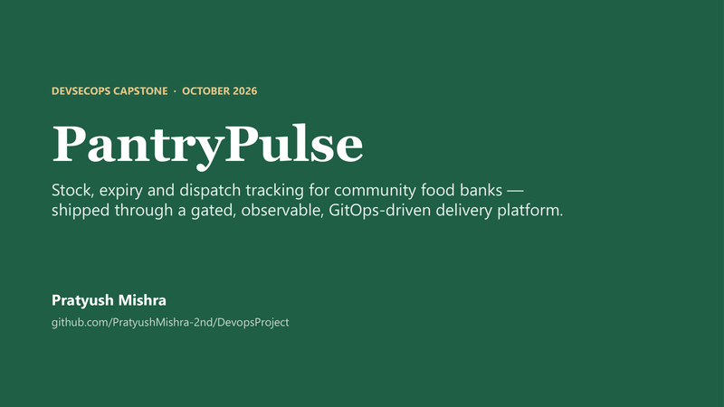
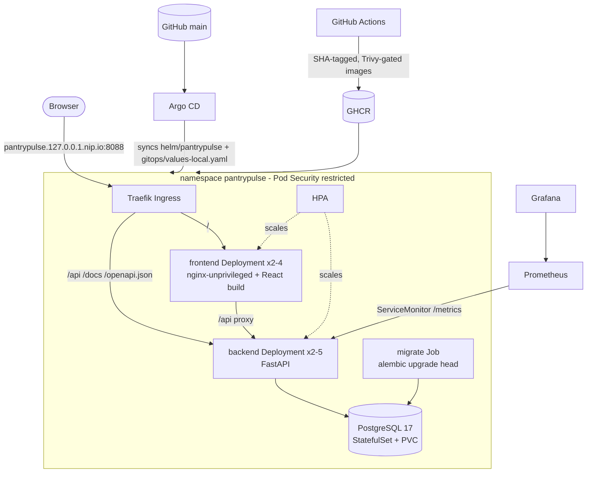

# PantryPulse

**Stock, expiry and dispatch tracking for community food banks.** Built as
a DevSecOps capstone by Pratyush Mishra.

Food banks receive donated stock with very different shelf lives and
dispatch it to partner shelters and kitchens. PantryPulse helps them in
four ways:

- It shows what is on the shelf and what expires soon (the *expiry radar*).
- It records who donated what.
- It logs every dispatch.
- It refuses unsafe operations: dispatching expired or held stock,
  dispatching more than is left, or deleting a lot that has dispatch
  history.

Around that application sits the full delivery platform:

- tests and code quality gates
- containers
- a gated CI/CD pipeline with Trivy
- GHCR images tagged by commit SHA
- Terraform for AWS EKS
- Helm on Kubernetes with Traefik Ingress and an HPA
- Argo CD GitOps
- Prometheus and Grafana

| | |
|---|---|
| Repository | https://github.com/PratyushMishra-2nd/DevopsProject |
| Images | `ghcr.io/pratyushmishra-2nd/pantrypulse-backend:<sha>`, `ghcr.io/pratyushmishra-2nd/pantrypulse-frontend:<sha>` |
| Demo | [`demo/presentation.mp4`](demo/presentation.mp4) (12 min: slides, then a live walkthrough), [slides PPTX](demo/presentation.pptx) / [PDF](demo/presentation.pdf), [script](demo/DEMO-SCRIPT.md) |
| Evidence | [`docs/evidence/EVIDENCE-MANIFEST.md`](docs/evidence/EVIDENCE-MANIFEST.md) |
| Rubric checklist | [`docs/SUBMISSION-CHECKLIST.md`](docs/SUBMISSION-CHECKLIST.md) |



> **AWS status (2026-10-16):** the Terraform in `terraform/` was applied to
> AWS `ap-south-1`: VPC with 2 public + 2 private subnets, EKS 1.35 cluster
> `pantrypulse-eks` and a managed node group (3 × t3.micro, all nodes
> Ready), then destroyed. Console and CLI evidence is listed under M7 in the
> [submission checklist](docs/SUBMISSION-CHECKLIST.md). The app itself,
> Argo CD and monitoring are demonstrated on a local kind cluster.

---

## Contents

1. [Architecture](#architecture)
2. [Technology stack](#technology-stack)
3. [Quick start](#quick-start)
4. [Application and API](#application-and-api)
5. [Testing and code quality](#testing-and-code-quality)
6. [Docker](#docker)
7. [CI/CD](#cicd)
8. [DevSecOps](#devsecops)
9. [Terraform (AWS)](#terraform-aws)
10. [Kubernetes and Helm](#kubernetes-and-helm)
11. [GitOps with Argo CD](#gitops-with-argo-cd)
12. [Observability](#observability)
13. [Troubleshooting](#troubleshooting)
14. [Repository layout](#repository-layout)
15. [Documentation index](#documentation-index)

---

## Architecture



Delivery flow:

1. A push to `main` runs CI: tests, linters, SAST, dependency audit, secret
   scan and IaC checks.
2. CI builds both images and runs the Trivy gate.
3. The images are pushed to GHCR, tagged with the commit SHA.
4. CI deploys that exact SHA to an ephemeral kind cluster and smoke-tests it
   through the Ingress.
5. Promotion to the long-lived environment is a reviewed Git commit
   (`scripts/promote.sh`). Argo CD applies it.

## Technology stack

| Layer | Choice |
|-------|--------|
| Frontend | React 19, Vite 8; served by `nginx-unprivileged` 1.30 with a strict CSP; Fraunces + Manrope fonts, self-hosted |
| Backend | Python 3.12, FastAPI 0.143, SQLAlchemy 2.1, Pydantic 2, Alembic 1.20, psycopg 3 |
| Database | PostgreSQL 17 (alpine) |
| Tests | pytest + coverage (89%), httpx; vitest + Testing Library |
| Quality / security | ruff, bandit, pip-audit, eslint, prettier, npm audit, gitleaks, Trivy (image + IaC), Dependabot |
| Containers | Docker multi-stage builds, Docker Compose |
| CI/CD | GitHub Actions, GHCR, SPDX SBOM, build provenance attestations |
| IaC | Terraform 1.16, AWS provider 6.x: VPC, EKS 1.35, managed node group, IAM, EBS CSI |
| Kubernetes | kind 0.33 (Kubernetes 1.37) locally; Helm 4 chart; Traefik 3.7 Ingress; metrics-server + HPA |
| GitOps | Argo CD 3.5 |
| Observability | kube-prometheus-stack 92.3 (Prometheus, Grafana 13), ServiceMonitor, provisioned dashboard |

Design decisions are recorded as ADRs in [`docs/adr/`](docs/adr/).

## Quick start

**Docker Compose** (the application only):

```bash
docker compose up --build --detach --wait
# UI   http://localhost:3000
# API  http://localhost:8000/docs
```

**Full platform on kind** (Kubernetes, Ingress, HPA, Prometheus/Grafana,
Argo CD):

```bash
scripts/cluster-up.sh          # kind + Traefik + metrics-server
scripts/install-monitoring.sh  # Prometheus + Grafana + dashboard
scripts/install-argocd.sh      # Argo CD + the PantryPulse Application
# App      http://pantrypulse.127.0.0.1.nip.io:8088
# Argo CD  http://argocd.127.0.0.1.nip.io:8088
# Grafana  http://grafana.127.0.0.1.nip.io:8088
```

Step-by-step guides:

- [local development runbook](docs/runbooks/local-development.md)
- [kind platform runbook](docs/runbooks/kind-platform.md)

## Application and API

The UI has four views:

| View | Shows |
|------|-------|
| **Shelf** | Lot cards with a freshness bar, plus KPIs: lots, expiring in 7 days, expired-on-shelf, dispatched this week, partners served |
| **Expiry radar** | Lots expiring soon |
| **Donors** | Donor records |
| **Dispatch log** | Every dispatch |

All create and edit operations happen in drawers, with loading, empty and
error states. Screenshots are in
[`docs/evidence/screenshots/`](docs/evidence/screenshots/) (`m1-*`, `m4-*`,
`m8-app-*`).

| Method | Path | Purpose |
|--------|------|---------|
| GET | `/health` | liveness |
| GET | `/ready` | readiness: DB reachable **and** migrations applied, otherwise 503 |
| GET | `/metrics` | Prometheus metrics |
| GET | `/api/info` | service name, environment, deployed `git_sha` |
| GET / POST | `/api/lots` | list (filters: category, storage, status, expiring_within, q search) / receive stock |
| GET / PUT / DELETE | `/api/lots/{id}` | read / update / delete; delete returns 409 while the lot has dispatches |
| GET | `/api/lots/summary` | KPI counts by category and storage |
| GET / POST | `/api/donors` | list / create; duplicate name returns 409 |
| GET / PUT / DELETE | `/api/donors/{id}` | read / update / delete |
| GET / POST | `/api/dispatches` | log / dispatch: quantity is decremented; more than is left returns 422; an expired or held lot returns 409 |
| DELETE | `/api/dispatches/{id}` | void a dispatch and restore the quantity |

Schema and data:

- The schema is managed by Alembic:
  - `0001_donors_lots` creates donors and stock lots.
  - `0002_dispatches` creates dispatches.
- Logs are JSON lines.
- Demo data comes from `python -m app.seed`, which is idempotent.

## Testing and code quality

Backend:

- 33 pytest tests across `/health`, `/ready`, `/api/info`, lots, donors and
  dispatches.
- They run against an in-memory SQLite database through FastAPI dependency
  overrides, never a real database (`backend/tests/conftest.py`,
  `pytest.ini`).
- 2 more tests marked `postgres` run Alembic and the API against a real
  PostgreSQL 17. In CI they use a service container.
- Coverage is 89%.

Frontend:

- 15 vitest tests.

Tooling:

- **Linters and formatters:** ruff (lint + format), eslint, prettier.
- **Security checks:** bandit (SAST), pip-audit and npm audit (dependency
  CVEs).

```bash
cd backend && pytest -v          # 33 passed, 2 skipped without TEST_POSTGRES_URL
cd frontend && npx vitest run    # 15 passed
```

Evidence:

- [pytest screenshot](docs/evidence/screenshots/m2-pytest-passing.png)
- [vitest screenshot](docs/evidence/screenshots/m2-frontend-vitest.png)

## Docker

| Image | Build | Runtime user |
|-------|-------|--------------|
| `backend/Dockerfile` | 2-stage: builder creates a venv; runtime `python:3.12-slim-trixie` with no build tools | UID 10001 |
| `frontend/Dockerfile` | 2-stage: `node:24-alpine` builds the Vite bundle; runtime `nginxinc/nginx-unprivileged:1.30-alpine` on port 8080 | UID 101 |

[`docker-compose.yml`](docker-compose.yml) runs three services:

- `postgres`: health-checked, named volume `pgdata`, no host port.
- `backend`: waits for a healthy Postgres, runs the migrations, seeds the
  demo data.
- `frontend`: waits for a healthy backend.

Evidence:

- [compose up screenshot](docs/evidence/screenshots/m4-docker-compose-up.png)
- [app on localhost:3000](docs/evidence/screenshots/m4-app-at-localhost-3000.png)
- [non-root check](docs/evidence/screenshots/m4-containers-non-root.png)
- [persistence across down/up](docs/evidence/screenshots/m4-volume-persistence.png)

## CI/CD

The workflow is [`.github/workflows/ci-cd.yml`](.github/workflows/ci-cd.yml).
It runs on push to `main`, on PRs and manually. Every action is pinned to a
commit SHA.

| Job | Does |
|-----|------|
| `backend` | ruff, bandit, pip-audit, pytest (plus Postgres integration) with coverage report |
| `frontend` | eslint/prettier, vitest, npm audit, `vite build` |
| `secret-scan` | gitleaks over the full history |
| `iac` | terraform fmt/validate/test, helm lint/template, Trivy config scans |
| `build-scan-push` | builds both images; **Trivy gate**; pushes `:<commit-sha>` to GHCR; SPDX SBOMs; provenance attestations |
| `deploy-kind` | verifies the attestations; creates kind + Traefik; `helm upgrade --install` with that SHA; smoke test through the Ingress (the deployed `git_sha` must equal `GITHUB_SHA`, the UI must load, `POST /api/lots` must return 201) |

Evidence:

- Fully green run:
  [38298132560](https://github.com/PratyushMishra-2nd/DevopsProject/actions/runs/38298132560)
  ([screenshot](docs/evidence/screenshots/m5-ci-run-all-jobs-green.png)).
- [GHCR packages](docs/evidence/screenshots/m5-ghcr-backend-package.png).
- A real failure the pipeline caught:
  [38282550447](https://github.com/PratyushMishra-2nd/DevopsProject/actions/runs/38282550447)
  failed on a Traefik values schema error. It was fixed in `54a966e`.

Details: [docs/engineering/ci-cd.md](docs/engineering/ci-cd.md).

## DevSecOps

The image gate runs in `build-scan-push`, **before** the push:

```
trivy image --exit-code 1 --severity HIGH,CRITICAL --ignore-unfixed --scanners vuln,secret
```

Any fixable HIGH or CRITICAL CVE in either image fails the job, and nothing
is published.

**The scan result is clean, and here is why.** The latest scans report **0**
HIGH/CRITICAL findings for both images:

- backend on Debian 13.7
- frontend on Alpine 3.24.2

([screenshot](docs/evidence/screenshots/m6-trivy-gate-ci-log.png)).

That comes from choices that keep the attack surface small:

- Current minimal bases: `python:3.12-slim-trixie` and
  `nginx-unprivileged:1.30-alpine3.24`.
- A multi-stage backend build, so compilers and pip caches never reach the
  runtime image.
- Pinned, current dependencies, which Dependabot updates.

The informational full report (all severities) is kept as a CI artifact, so
lower-severity and unfixed findings are still visible.

Other controls:

- gitleaks across the whole history
- bandit, pip-audit and npm audit
- Trivy IaC scans on Terraform and the rendered Helm chart
- non-root containers with read-only root filesystems
- Pod Security `restricted`
- a NetworkPolicy around PostgreSQL
- no secrets in Git (`.gitignore` covers `.env`, tfvars, state and
  kubeconfigs)

Details: [docs/engineering/security.md](docs/engineering/security.md).

## Terraform (AWS)

[`terraform/`](terraform/) uses plain AWS resources (no community modules),
in `ap-south-1`:

- VPC `10.42.0.0/16` with **2 public + 2 private subnets** across two AZs,
  internet gateway and route tables, optional NAT gateway.
- EKS **1.35** with a managed node group (`t3.medium` × 2, scaling 1–3).
- IAM roles; core add-ons plus metrics-server; the EBS CSI driver via Pod
  Identity.
- API endpoint access restricted to your own `/32`.

Cost switches (NAT, KMS, control-plane logs) default to off, see
[ADR 0003](docs/adr/0003-eks-without-nat.md).

```bash
cd terraform
cp terraform.tfvars.example terraform.tfvars   # set api_allowed_cidrs
terraform init && terraform plan
```

Verified without an AWS account:

- `terraform init`
- `validate`
- `terraform test` (4 passed)
- an offline `terraform plan` → **Plan: 29 to add, 0 to change, 0 to
  destroy**

[Screenshot](docs/evidence/screenshots/m7-terraform-plan.png).

**Applied on AWS (2026-10-16):** the full stack was applied in `ap-south-1`
and destroyed the same evening:

- [VPC](docs/evidence/screenshots/m7-aws-console-vpc.png) and
  [subnets](docs/evidence/screenshots/m7-aws-console-subnets.png) in the AWS Console
- [EKS cluster Active](docs/evidence/screenshots/m7-aws-console-eks-clusters.png),
  [3 nodes Ready](docs/evidence/screenshots/m7-aws-console-eks-nodes.png),
  [kubectl](docs/evidence/screenshots/m7-aws-eks-kubectl.png)
- [terraform destroy](docs/evidence/screenshots/m7-terraform-destroy-eks.png) and the
  [empty cluster list](docs/evidence/screenshots/m7-aws-console-eks-empty.png)

Account constraints met on the way (recorded in
[ADR 0008](docs/adr/0008-free-tier-ec2-k3s.md)): the account only launches
free-tier instance types, so the node group ran **t3.micro** with VPC CNI
prefix delegation (configured before the nodes join) instead of t3.medium,
and the EBS CSI add-on could not be created (`iam:PassRole` denied on its
role).

## Kubernetes and Helm

The chart is [`helm/pantrypulse/`](helm/pantrypulse/) (`Chart.yaml`,
`values.yaml`, `values-dev.yaml`, `values-eks.yaml`, templates):

- **Workloads:**
  - backend and frontend Deployments, 2 replicas minimum, each with an HPA
  - ClusterIP Services
  - PostgreSQL StatefulSet with a PVC
  - migration Job, per release or as an Argo CD hook
- **Ingress:** className `traefik`. `/` goes to the frontend; `/api`,
  `/docs` and `/openapi.json` go to the backend.
- **Policies:** PDBs, a NetworkPolicy, and a ServiceMonitor.
- **Guards:** the chart refuses to render without an image SHA, and without
  a database password or an existing Secret.

The namespace manifest is [`k8s/namespace.yaml`](k8s/namespace.yaml), with
Pod Security `restricted`.

```bash
scripts/deploy-local.sh <sha>      # helm upgrade --install ... --wait --wait-for-jobs
kubectl -n pantrypulse get pods,svc,ingress,hpa
```

Evidence:

- [kubectl get pods/svc/ingress/hpa](docs/evidence/screenshots/m8-kubectl-get-pods-svc-ingress-hpa.png)
- [helm list](docs/evidence/screenshots/m8-helm-list-and-history.png)
- [app through the Ingress](docs/evidence/screenshots/m8-app-through-ingress.png)
- [HPA scaling 2→5→2 under load](docs/evidence/screenshots/m8-hpa-autoscaling.png)

## GitOps with Argo CD

[`gitops/application.yaml`](gitops/application.yaml) points Argo CD at the
chart on `main`, plus [`gitops/values-local.yaml`](gitops/values-local.yaml)
(the environment's image SHAs). Sync is automated, with prune and
self-heal.

| Action | How |
|--------|-----|
| Promotion | `scripts/promote.sh <sha>` (refuses SHAs not in GHCR), then push |
| Rollback | `git revert`, then push |

Recorded drill:

- [Promotion](docs/evidence/screenshots/m8-gitops-promotion.png): `161f84e`
  → `8be415d` (commit 7038d15).
- [Rollback](docs/evidence/screenshots/m8-gitops-rollback.png) by revert
  (commit c1fc74c).
- [Argo CD application tree](docs/evidence/screenshots/m8-argocd-app-tree.png).

Details: [docs/engineering/gitops.md](docs/engineering/gitops.md).

## Observability

- **Metrics:** `/metrics` exposes HTTP request counts and latency histograms
  by handler, method and status, plus business counters (lots received,
  quantity dispatched).
- **Scraping:** kube-prometheus-stack discovers every API pod through the
  chart's ServiceMonitor.
- **Dashboard:** the provisioned Grafana dashboard *PantryPulse - API
  overview* shows request rate, p95 latency, 5xx ratio, targets UP, per-
  endpoint rate and latency, HPA replicas with pod CPU, and food
  dispatched.

Evidence:

- [/metrics](docs/evidence/screenshots/m9-backend-metrics-curl.png)
- [Prometheus targets UP](docs/evidence/screenshots/m9-prometheus-targets-up.png)
- [Grafana dashboard](docs/evidence/screenshots/m9-grafana-dashboard.png)

Details: [docs/engineering/observability.md](docs/engineering/observability.md).

## Troubleshooting

[`troubleshooting/`](troubleshooting/README.md) holds four reproducible
failure labs in an isolated namespace:

1. ImagePullBackOff
2. a Service with no endpoints
3. a migration Job that cannot reach its database
4. a pod that runs but is never Ready

Each was broken, diagnosed and fixed on the cluster, with transcripts.

The same README lists the **real** incidents hit while building this:

- a Docker Hub DNS failure during the first Helm install
- a Traefik hostPort rollout deadlock
- Grafana GC thrash under its memory limit
- the CI schema failure

Rollback procedures: [docs/runbooks/rollback.md](docs/runbooks/rollback.md).

## Repository layout

```
backend/           FastAPI app, Alembic migrations, pytest suite, Dockerfile
frontend/          React + Vite app, vitest suite, nginx config, Dockerfile
docker-compose.yml local three-service stack
.github/           CI/CD workflow, Dependabot
terraform/         AWS VPC + EKS (plain resources), tfvars example, terraform tests
k8s/               namespace, kind config, gp3 StorageClass, Traefik values (kind/EKS)
helm/pantrypulse/  application chart (dev and EKS profiles)
gitops/            Argo CD Application, Argo CD values, environment values
monitoring/        kube-prometheus-stack values, Grafana dashboard JSON
troubleshooting/   failure labs + README
scripts/           cluster/monitoring/Argo CD install, deploy, promote, load, traffic, UI smoke, transcript recorder
security/          documented Trivy IaC exceptions
docs/              ADRs, engineering notes, runbooks, evidence (screenshots + transcripts)
demo/              presentation video, slides (PPTX/PDF), preview GIF, demo script
```

## Documentation index

| Area | Documents |
|------|-----------|
| Decisions | [ADR 0001 stack](docs/adr/0001-application-stack.md), [0002 SHA tags + Trivy gate](docs/adr/0002-immutable-sha-image-tags.md), [0003 EKS without NAT](docs/adr/0003-eks-without-nat.md), [0004 Traefik](docs/adr/0004-traefik-ingress-controller.md), [0005 Argo CD](docs/adr/0005-gitops-with-argo-cd.md), [0006 migrations Job](docs/adr/0006-migrations-as-a-job.md), [0007 kind vs EKS](docs/adr/0007-local-kind-as-the-demo-cluster.md), [0008 free-tier EC2 + k3s](docs/adr/0008-free-tier-ec2-k3s.md) |
| Engineering | [CI/CD](docs/engineering/ci-cd.md), [security](docs/engineering/security.md), [GitOps](docs/engineering/gitops.md), [observability](docs/engineering/observability.md) |
| Runbooks | [local development](docs/runbooks/local-development.md), [kind platform](docs/runbooks/kind-platform.md), [AWS EKS](docs/runbooks/aws-eks.md), [AWS EC2 + k3s (free tier)](docs/runbooks/aws-ec2-k3s.md), [rollback](docs/runbooks/rollback.md) |
| Evidence | [manifest](docs/evidence/EVIDENCE-MANIFEST.md), [submission checklist](docs/SUBMISSION-CHECKLIST.md), [transcripts](docs/evidence/transcripts/), [screenshots](docs/evidence/screenshots/) |
| Demo | [demo script](demo/DEMO-SCRIPT.md), video and slides in [`demo/`](demo/) |

### How the evidence was produced

- **Terminal evidence.** [`scripts/record.sh`](scripts/record.sh) runs each
  command for real and writes its output, verbatim, to
  `docs/evidence/transcripts/`. The PNGs in `docs/evidence/screenshots/`
  are renders of those transcripts, and each image names its source file.
- **Browser evidence.** Browser screenshots were captured headlessly with
  Playwright from the URL shown in their address bar.
- **What is not included.** There are no AWS screenshots, because nothing
  was provisioned.
