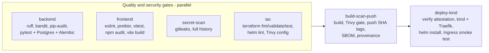

# CI/CD pipeline

Workflow: [`.github/workflows/ci-cd.yml`](../../.github/workflows/ci-cd.yml).
It runs on every push to `main`, on every pull request to `main`, and
manually.

| Job | What fails it |
|-----|---------------|
| Backend | ruff lint/format; bandit (medium+ severity and confidence); pip-audit; any pytest failure, including Postgres integration tests and `alembic upgrade head` against a real PostgreSQL 17 service |
| Frontend | eslint or prettier; vitest; `npm audit --omit=dev --audit-level=high`; production build |
| Secret scan | any gitleaks finding in any commit |
| IaC | `terraform fmt -check`; `terraform validate`; `terraform test` (plan-time assertions with no AWS account); `helm lint`/`template`; Trivy MEDIUM+ misconfiguration that is not in the documented accept-list |
| Build, scan, publish | image build; **Trivy HIGH/CRITICAL with an available fix in either image** (checked before the push); GHCR push; SBOM; attestation |
| Deploy to kind | attestation verification; Helm install with images pinned to this SHA; the smoke test, which requires `/api/info` to report this exact SHA through the Ingress, the UI to load, and `POST /api/lots` to return 201 |

## Publishing rules

- Pull requests run every gate, including the image build and Trivy scan,
  but never push to GHCR.
- On `main`, images are pushed only after all four gate jobs **and** the
  Trivy gate pass.
- Tags are the full commit SHA only
  ([ADR 0002](../adr/0002-immutable-sha-image-tags.md)).

## Evidence

- A fully green run (6/6 jobs):
  [run 38298132560](https://github.com/PratyushMishra-2nd/DevopsProject/actions/runs/38298132560)
  ([screenshot](../evidence/screenshots/m5-ci-run-all-jobs-green.png)).
- A real failure caught by the pipeline:
  - [Run 38282550447](https://github.com/PratyushMishra-2nd/DevopsProject/actions/runs/38282550447):
    `deploy-kind` failed on a Traefik values schema error.
  - Fixed in commit `54a966e`.
- Trivy gate output:
  [screenshot](../evidence/screenshots/m6-trivy-gate-ci-log.png),
  [transcript](../evidence/transcripts/ci-trivy-gate.txt).
- GHCR packages:
  [backend](https://github.com/users/PratyushMishra-2nd/packages/container/package/pantrypulse-backend),
  [frontend](https://github.com/users/PratyushMishra-2nd/packages/container/package/pantrypulse-frontend).
