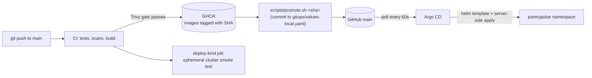

# GitOps delivery



## Pieces

| File | Purpose |
|------|---------|
| [`gitops/application.yaml`](../../gitops/application.yaml) | Argo CD `Application`: chart `helm/pantrypulse` @ `main`, automated sync with prune + self-heal, HPA-owned replicas ignored |
| [`gitops/values-local.yaml`](../../gitops/values-local.yaml) | Desired state of the environment: image tags (a commit SHA), `database.existingSecret`, migrations as a Sync hook |
| [`gitops/argocd-values.yaml`](../../gitops/argocd-values.yaml) | Argo CD 3.5 (chart argo-cd 10.10.3), UI at `http://argocd.127.0.0.1.nip.io:8088`, 60 s reconciliation |
| [`scripts/install-argocd.sh`](../../scripts/install-argocd.sh) | Installs Argo CD, creates the DB Secret once, applies the Application |
| [`scripts/promote.sh`](../../scripts/promote.sh) | Checks the SHA's images exist in GHCR, rewrites the tags, commits |

## Promote a build

1. Wait for the CI run of the commit you want to release to go green. It
   publishes `ghcr.io/pratyushmishra-2nd/pantrypulse-{backend,frontend}:<sha>`.
2. Promote it:

   ```bash
   scripts/promote.sh <full-40-char-sha>
   git push origin main
   ```

3. Argo CD picks up the commit within its reconciliation interval. During
   the sync:
   - The migration hook Job runs.
   - The Deployments roll to the new tag.
   - `GET /api/info` returns the new `git_sha`.

Recorded run ([transcript](../evidence/transcripts/gitops-promotion.txt)):

- Commit `7038d15` moved the environment from `161f84e` to `8be415d`.
- Argo CD went `OutOfSync` → `Synced/Degraded` (pods rolling) →
  `Synced/Healthy` in about 40 s.

## Roll back

```bash
git revert <promotion-commit>
git push origin main
```

Recorded run ([transcript](../evidence/transcripts/gitops-rollback.txt)):
commit `c1fc74c` reverted `7038d15`, and the cluster was back on `161f84e`
within one sync. Argo CD history shows all three revisions.

Do not use `helm rollback` or `kubectl edit` on an Argo-managed release.
Self-heal reverts manual changes to match Git, which is the point. For a
release installed with plain Helm (no Argo CD), use
[the rollback runbook](../runbooks/rollback.md).

## Why CI does not deploy to the long-lived environment

CI deploys every commit to a throwaway kind cluster as an end-to-end test.
The long-lived environment changes only through a reviewed commit:

- every deployment has an author and a diff
- Git history is the audit log
- recovery is `git revert`

See [ADR 0005](../adr/0005-gitops-with-argo-cd.md).
